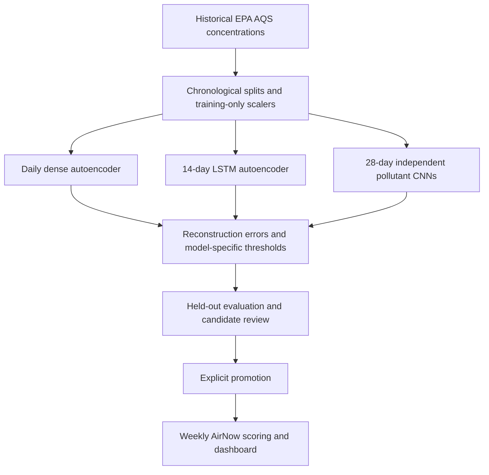

# Model development

The maintained pipeline has three reconstruction models: a dense autoencoder, a 14-day LSTM autoencoder, and independent 28-day CNN autoencoders for PM2.5 and ozone. The runnable implementations live in `src/air_quality_tracker`; notebooks provide exploration and entry points.

These models learn from pollutant concentrations, with seasonal sine/cosine features for the dense and LSTM models. Weather ingestion, forecasting, GRU models, and variational autoencoders are exploratory ideas rather than deployed features.

Training uses 2021–2023. The dense and LSTM models use 2024 for validation and 2025 for held-out testing. The CNN uses January–June 2024 for early stopping and July–December for independent threshold calibration, then tests on 2025. Windows cannot cross split boundaries or gaps.

The dense network has hidden layers of 3, 2, and 3 units. Its threshold is the training 95th percentile of reconstruction MSE. The LSTM has a 32/16 encoder, repeated latent representation, and a 16/32 decoder; separate validation 99th-percentile pollutant thresholds apply to end-day absolute standardized errors. The CNN uses strided convolution, dropout, and an upsampling decoder, with separate calibration 99th-percentile window MSE thresholds.

Compare models on common dates using errors in pollutant units and report coverage alongside the results. Their raw losses use different definitions. CNN window flags and daily flags also describe different intervals.

An observed-concentration exceedance is a useful independent benchmark, but it is not a verified event label. None of the deployed models forecasts future concentrations. See the [project guide](../README.md) for local commands and the retraining review process.
